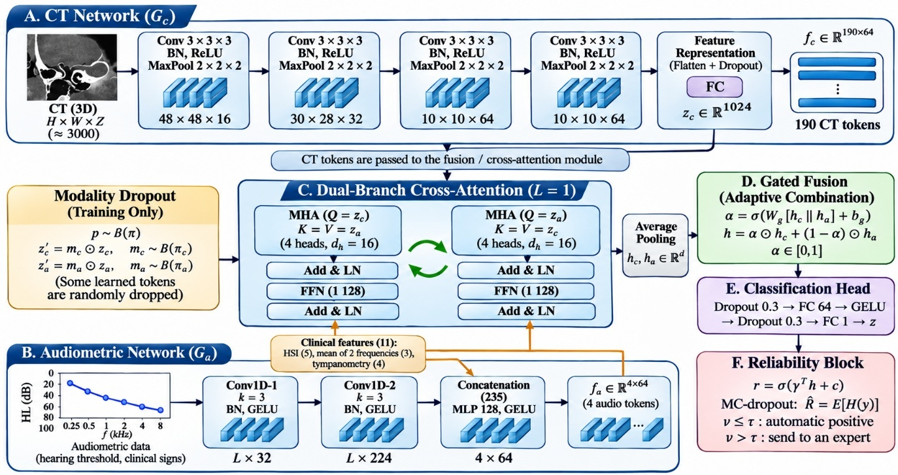

# CAGF-Net: Cross-Attention Gated Fusion of CT Imaging and Audiometric Signals for Cholesteatoma Detection

Reference implementation of the paper

> A Reliable Neural Network Model Based on Cross-Attention Fusion of CT Imaging and Audiometric Signals for Cholesteatoma Detection.
CAGF-Net combines a temporal-bone CT region of interest with pure-tone audiometry and tympanometry.
Its design is motivated by a Bayesian analysis of evidence fusion:

| Paper idea | Implementation |
|---|---|
| Logit / additive evidence, Eq. (1)–(2) | `late_fusion`: λ = λ_t + λ_a − λ₀ from calibrated single-modality logits |
| Interaction term φ, Eq. (3) | bidirectional cross-attention (`CrossAttentionBlock`) |
| Reliability-dependent weighting | gated fusion (`GatedFusion`), Eq. (5) |
| Missing modality | learned surrogate tokens + modality-dropout (p_md = 0.2) |
| Calibration | temperature scaling with shift, p = σ(z/T + c) |
| Uncertainty | MC-dropout (R = 30), normalised entropy u = H(p̄)/ln 2, selective prediction |



## Hybrid simulation benchmark

No public dataset of paired CT and audiometry with surgical confirmation exists. The benchmark is therefore **hybrid**:

* **Audiometric background:** real NHANES 2015–2016 audiometry (AUX_I) for ages 20–69. Ears are kept if they have normal otoscopy and a Type A tympanogram (0.3 ≤ Y ≤ 1.75 ml, p₀ > −100 daPa). Codes 666 and 888 are treated as missing. Donors are split at participant level into internal and external pools.
* **Synthetic pathology:** each simulated ear gets a class (normal 30 %, ETD 25 %, COM 25 %, cholesteatoma 20 %) and a severity s ~ U(0.1, 1). A conductive component is added to the donor thresholds: 15 + 20s dB (ETD), 15 + 24s dB (COM) or 16 + 28s dB (cholesteatoma, larger at high frequencies). Tympanograms are drawn from class-specific mixtures (types C, B and Ad, plus large equivalent volume).
* **CT phantom:** a parametric axial temporal-bone phantom, 80×80 pixels in HU, showing the tympanic cavity, attic, EAC, ossicles, scutum and mastoid cells. Pathology is added on top: fluid (ETD); mucosal thickening, granulation and sclerosis (COM); an attic soft-tissue mass with ossicular erosion and scutum blunting (cholesteatoma). The image is then blurred and gets 110–180 HU of noise.
* **External domain:** a different scanner (160–240 HU noise, stronger blur, ±30 HU offset) and audiometer (+3 dB shift), using donors never seen in training.

Split sizes: train 1200, validation 400, internal test 400, external 600.

> ⚠️ The CT component is a phantom and the pathology is synthetic. Results are a **simulation-based validation** of the method and must not be read as clinical performance.

## Installation

```bash
git clone https://github.com/aaotemirov/Paper_article.git
cd Paper_article
python -m venv .venv && source .venv/bin/activate     # Windows: .venv\Scripts\activate
pip install -r requirements.txt
```

Python ≥ 3.10 and PyTorch ≥ 2.0 are required. A CPU is sufficient: the full protocol takes about 30–60 minutes on 8 cores.

## Usage

```bash
# 1) quick offline smoke test (synthetic audiometric background, ~2 min)
python -m cagfnet.experiments --config configs/quick.yaml

# 2) full paper protocol (downloads NHANES AUX_I/DEMO_I from CDC on first run, ~5 MB)
python -m cagfnet.experiments --config configs/default.yaml

# options
python -m cagfnet.experiments --config configs/default.yaml --seeds 0 --models ct_only cagf_net --epochs 10
```

Outputs are written to `results/<name>/`:

| File | Content |
|---|---|
| `table1_internal.md/.csv` | AUC, AP, sensitivity, specificity, F1, ECE, Brier (mean ± std over seeds) |
| `table2_external.md/.csv` | results under artificial domain shift (AUC drop, sensitivity, ECE) |
| `ablation.md/.csv` | CAGF-Net without cross-attention / gate / modality-dropout |
| `noise_robustness.csv` | AUC vs. additional CT noise |
| `missing_modality.csv` | performance with CT or audiometry replaced by surrogate tokens |
| `severity_sensitivity.csv` | sensitivity per cholesteatoma severity group |
| `uncertainty.json` | entropy-based error detection AUC, accuracy at 80 % coverage |
| `delong.csv` | DeLong tests CAGF-Net vs. each model |
| `figures/` | dataset samples, ROC/PR, noise & domain shift, severity, uncertainty |
| `checkpoints/` | trained weights per model and seed |

### Single-ear prediction

```bash
python scripts/predict.py --checkpoint results/paper/checkpoints/cagf_net_seed0.pt \
    --ct roi_hu.npy --ac 15 20 25 35 45 40 45 --bc 5 5 10 10 15 --tymp -180 1.2 160 0.4 --T 1.0 --c 0.0
```

For real DICOM data, convert pixel values with `cagfnet.data.phantom.dicom_to_hu` (HU = s·v + b) and crop an 80×80 ROI around the tympanic cavity and attic.

### Tests

```bash
python -m unittest discover -s tests -v
```

## Repository structure

```
cagfnet/
  config.py            default configuration (paper protocol)
  data/nhanes.py       NHANES download, cleaning, participant-level split
  data/audiometry.py   conductive-loss and tympanogram simulation, audio features
  data/phantom.py      parametric CT phantom, dual-window encoding
  data/dataset.py      hybrid dataset generation, caching, torch Dataset
  models.py            CT/audio encoders, cross-attention, gated fusion, baselines, ablations
  training.py          weighted BCE training, MC-dropout, entropy
  calibration.py       temperature + shift calibration
  metrics.py           AUC/AP, Youden threshold, ECE, Brier, bootstrap CI, DeLong test
  experiments.py       end-to-end runner (tables, statistics)
  plots.py             figures
configs/               default.yaml (paper) and quick.yaml (smoke test)
scripts/               download_nhanes.py, predict.py
tests/                 unit tests
```

## Limitations

* The CT data are a 2-D parametric phantom, not real temporal-bone anatomy.
* The dependence between CT and audiometry is induced only through the class and the severity parameter.
* NHANES does not measure bone conduction. The bone-conduction curve is therefore derived from the air-conduction thresholds of ears with a normal middle ear.
* Clinical validation requires surgically confirmed, paired CT–audiometry data. The code is designed to accept such data: replace the phantom and generator with real ROIs and audiograms.

## Data licence

NHANES data are produced by the U.S. National Center for Health Statistics (CDC/NCHS) and are in the public domain. They are downloaded at run time and are not redistributed in this repository.

## Citation

```bibtex
@inproceedings{temirov2027cagfnet,
  title     = {A Reliable Neural Network Model Based on Cross-Attention Fusion of CT Imaging and Audiometric Signals for Cholesteatoma Detection},
  author    = {Temirov Azizbek},
  booktitle = {The 10th International Conference on Emerging Data and Industry (EDI 2027)},
  series    = {Procedia Computer Science},
  publisher = {Elsevier},
  year      = {2027}
}
```

## License

Code released under the MIT License (see `LICENSE`).
